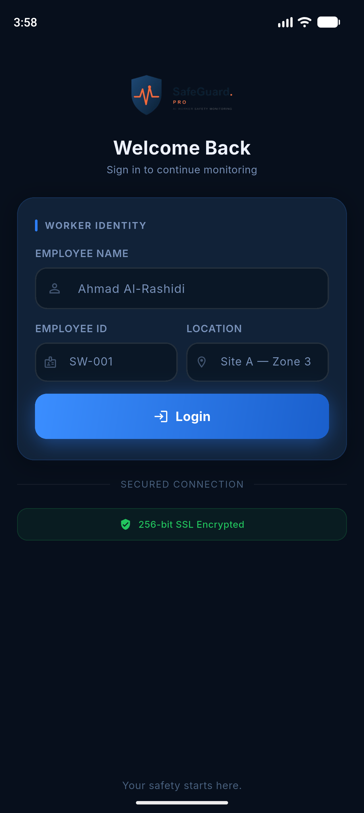

# SafeGuard Pro

**AI worker safety monitoring, on the worker's phone.**

SafeGuard Pro is a Flutter mobile app for workers on industrial sites. A worker signs in at the start of a shift, pairs their company-issued smartwatch over Bluetooth, and the app keeps the watch linked for the whole shift so their safety can be monitored.

This is a university capstone project.

<p align="center">
  
</p>

## Project status

All four screens are built. The app runs on **fake data** by default; the real backend client is written and can be switched on with one line (see [Backend](#backend)).

| Screen | What it does | Status |
|---|---|---|
| Login ("Welcome Back") | Worker enters name, Employee ID and work zone | ✅ Done |
| Device setup (Step 1 of 3) | Turn on Bluetooth and scan for smartwatches | ✅ Done (Bluetooth is simulated) |
| Choose a smartwatch (Step 2 of 3) | Pick the company-issued watch and connect. This **starts the shift** on the backend | ✅ Done |
| Shift protection active | Shows the shift summary. "End session" **ends the shift** on the backend | ✅ Done |

### The shift flow

```
Login  →  Scan for watch  →  Choose watch  →  Connected  →  End session  →  Login
 (checks fields      (fake          POST /api/session/start   POST /api/session/end
  on the phone)      Bluetooth)     returns session_id         with session_id
```

## Tech stack

| Purpose | Package |
|---|---|
| UI framework | [Flutter](https://flutter.dev) (stable channel) |
| State management | [flutter_bloc](https://pub.dev/packages/flutter_bloc) (Cubits) |
| Navigation | [go_router](https://pub.dev/packages/go_router) |
| Comparing states and models | [equatable](https://pub.dev/packages/equatable) |
| Talking to the backend | [dio](https://pub.dev/packages/dio) |
| Testing | flutter_test and [bloc_test](https://pub.dev/packages/bloc_test) |
| Code style | flutter_lints |

The font is [Inter](https://rsms.me/inter/), which is bundled in `assets/fonts/`.

## Getting started

### Requirements

- Flutter SDK (latest stable), which includes Dart
- Android Studio with an Android emulator, or a real Android phone

Check your setup with:

```bash
flutter doctor
```

### Run the app

```bash
git clone https://github.com/Shohstopper/safeguard-pro.git
cd safeguard-pro
flutter pub get
flutter run
```

### Try it out

With the fake data you can sign in with any name, Employee ID (for example `W001`) and zone.

| To see… | Do this |
|---|---|
| The whole flow | Log in, tap **Turn on Bluetooth & scan**, then **Connect smartwatch**, then **End session** |
| Field errors | Tap **Login** with one or more fields empty |
| "Could not start your shift" | Log in with the Employee ID **`W000`**, then connect |
| "No smartwatches found" / "Scan failed" | In `lib/app.dart`, give `MockBluetoothRepository` the option `outcome: MockScanOutcome.empty` or `MockScanOutcome.failure` |

## Backend

The backend API is described in [`docs/api_contract.md`](docs/api_contract.md). The worker app uses two endpoints:

| Endpoint | When |
|---|---|
| `POST /api/session/start` | Tapping **Connect smartwatch**. Sends `worker_name`, `worker_id`, `zone` and `device_id`, and gets back a `session_id` |
| `POST /api/session/end` | Tapping **End session**. Sends the `session_id` |

There is no login endpoint, so the Login screen only checks the fields on the phone.

**To use the real backend:**

1. Start the backend on your computer (it runs on port 5000).
2. In [`lib/app.dart`](lib/app.dart), change `MockSessionRepository()` to `ApiSessionRepository()`.
3. Check the address in [`lib/core/constants/api_constants.dart`](lib/core/constants/api_constants.dart):
   - **Android emulator:** `http://10.0.2.2:5000`. This is the default, because inside the emulator `localhost` means the emulator itself.
   - **Real phone:** your computer's Wi-Fi IP address, for example `http://192.168.1.20:5000`. The phone and computer must be on the same Wi-Fi.

Debug builds are allowed to use plain `http://` (set in `android/app/src/debug/AndroidManifest.xml`). A release build needs an `https://` backend.

Bluetooth is still simulated: `MockBluetoothRepository` always "finds" the Guardian Watch Pro (`GW6-001`). Real Bluetooth needs an extra package and phone permissions.

## Project structure

The code is organised **by feature**. Each feature has the same four folders, so every screen is built the same way.

```
lib/
  core/                     used by the whole app
    constants/              on-screen text, asset paths, backend URL and paths
    router/                 all app routes in one file
    session/                who is signed in and their active shift (app-wide)
    theme/                  colors, spacing, text styles, app theme
    utils/                  small helpers (form validators)
    widgets/                shared widgets (button, card, logo)
  features/
    login/                  the Login screen
      bloc/                 cubit and state: the screen's logic
      pages/                the full screen
      widgets/              small widgets used only on this screen
    device_setup/           Scan, Choose a smartwatch, Connected screens
      data/                 repositories: Bluetooth (fake) and session (fake + real API)
      bloc/                 one cubit per screen
      pages/
      widgets/
  app.dart                  creates repositories and app-wide cubits
  main.dart                 starts the app
test/                       same layout as lib/
```

### How data flows

```
Page (UI)  →  Cubit (logic)  →  Repository (data)
```

- **Pages** only draw the screen and call cubit methods.
- **Cubits** hold the logic and talk to the repository. Each loading screen has four states: initial, loading, success and failure.
- **Repositories** return data, or throw an error that the cubit turns into a failure state.

### Fake data (mock repositories)

Each repository is an abstract class with two versions:

- `MockXRepository` returns fake data after a short delay. **This is used now.**
- `ApiXRepository` calls the real backend. `ApiSessionRepository` is ready; see [Backend](#backend).

All repositories are created in one place, [`lib/app.dart`](lib/app.dart). Switching from fake to real data means changing **one line per repository** there.

### Design

The screens follow the project's Figma design. Every color, spacing value, corner radius and text style is defined once in [`lib/core/theme/`](lib/core/theme/) and used from there. Widgets never hardcode these values.

## Development

Run these after every change. All three must pass before a screen is considered done:

```bash
dart format .
flutter analyze
flutter test
```

- `flutter analyze` must report **zero issues**.
- Every cubit has `bloc_test` tests for its success, failure and empty or validation cases.
- Important shared widgets have widget tests.

Contributor rules (folder structure, Bloc usage, design rules) are in [`CLAUDE.md`](CLAUDE.md).
